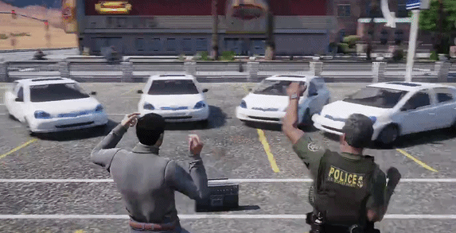

# sratzel_yaris_dance

yaris99 cars dance to "Why's this dealer".



| folder | what |
|---|---|
| [`sratzel_yarisdance`](sratzel_yarisdance) | the script, see its [README](sratzel_yarisdance/README.md) |
| [`yaris99`](yaris99) | the vehicle (Toyota Yaris 1999), see its [README](yaris99/README.md) for credits |

## quick start

1. needs [ox_lib](https://github.com/overextended/ox_lib) and [xsound](https://github.com/Xogy/xsound)
2. copy both folders into your resources
3. get the song yourself and put it at `sratzel_yarisdance/audio/whys_this_dealer.mp3`
   (not included, reference: https://www.youtube.com/watch?v=ZIMX1MfM9i8)
4. server.cfg:

```
ensure ox_lib
ensure xsound
ensure yaris99
ensure sratzel_yarisdance
```

5. get in a yaris, `/dealer` or `F7`

> [!WARNING]
> no boombox included. there's a hook for your own boombox script, see [boombox integration](sratzel_yarisdance/README.md#boombox-integration).

## license

code is MIT, see [LICENSE](LICENSE). song and vehicle are not covered.
